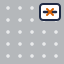
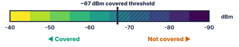
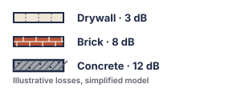
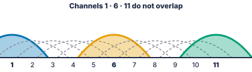
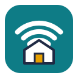
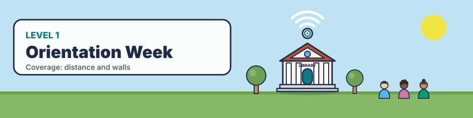
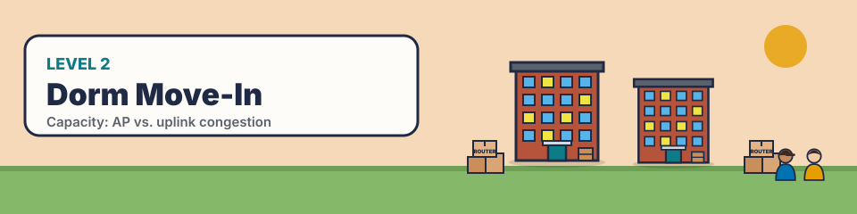
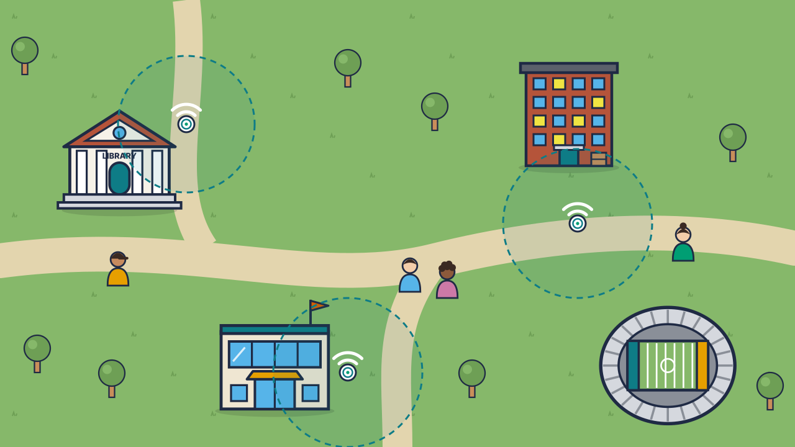

# Campus Connect assets

Original art and audio for **Campus Connect**, made for the game's developer to drop in. Everything here is
generated from code in [`_source/`](_source), so it is original (constitution principle: FR-038), has nothing to
license, and can be rebuilt byte-for-byte.

- **103 images**, each as a crisp **SVG** plus a ready-to-use **PNG**.
- **53 sounds**: music loops, sound effects, alarms, a dial-up modem, and gibberish voices for yelling users.
- [`manifest.json`](manifest.json): one entry per asset with its id, title, description, intended use and files.
  Load it to build a sprite or sound table without hard-coding paths.

## Using the assets

```js
const base = "assets/";                                    // file paths in the manifest are relative to assets/
const manifest = await (await fetch(base + "manifest.json")).json();
const byId = Object.fromEntries(manifest.assets.map(a => [a.id, a]));
new Audio(base + byId["sfx-ticket-open"].files.ogg).play();   // use .mp3 as a fallback for Safari
```

Use relative paths and keep the file names as they are (they are lower-case on purpose; GitHub Pages is case-sensitive).

## Rules these assets follow

- **Never colour-only.** Overlays use hatching and chevrons, channel badges show the number, status badges use
  different shapes. Always put the real value (dBm, %, Mbps) as text next to an icon (FR-035, FR-036).
- **Colour-blind safe palette.** Channels 1, 6 and 11 use blue, orange and green from the Okabe-Ito set.
  Overlapping channels are white with a dashed outline.
- **Every SVG has a `<title>` and `<desc>`**; the same text is in the manifest, so you can use it for `alt` text
  and `aria-label`.
- **Audio never carries information alone.** Every sound has an on-screen text equivalent (FR-036). Voices are
  gibberish, so there is nothing to caption or translate. Music is optional and should duck when the game is paused.
- **Loud sounds are marked.** `suggested_volume` in the manifest is a starting point. The alarms and voices are
  deliberately lower. Offer a mute toggle (`ui-sound-on` / `ui-sound-off` icons are included).
- Looping files are marked `"loop": true` and are cross-faded or whole-cycle, so they loop without a click.
  OGG and MP3 loop slightly differently in browsers: use OGG where it is supported.
- Wall losses and the other numbers named in descriptions are the spec's illustrative values. See `specs/001-campus-connect-playable/spec.md`.

## Image assets


### Equipment (8)

| Preview | Id | Title | Size | Use |
| --- | --- | --- | --- | --- |
|  | `ap` | Access point | 64×64 | Map sprite for a placed AP (FR-002). Pair it with a channel badge so the channel is never colour-only. |
|  | `ap-placement-preview` | Access point placement preview | 64×64 | Ghost sprite under the map cursor while placing an AP; swap to the solid sprite on confirm. |
|  | `ap-channel-conflict` | Access point with channel conflict | 64×64 | Map sprite when an AP has at least one conflicting neighbour (FR-007). Show the effective capacity number beside it. |
|  | `ap-overloaded` | Overloaded access point | 64×64 | Map sprite when an AP's users demand more than its capacity (FR-009). Show the utilisation % beside it. |
|  | `uplink-100mbps` | 100 Mbps uplink | 64×64 | Building uplink icon for the $200 100 Mbps option (FR-003). |
|  | `uplink-1gbps` | 1 Gbps uplink | 64×64 | Building uplink icon for the $800 1 Gbps option or an upgrade (FR-003). |
|  | `uplink-failed` | Failed uplink | 64×64 | Uplink icon after a scheduled failure (FR-011, Level 3). Pair it with the grey 'Uplink down' zone overlay. |
|  | `core-switch` | Campus core switch | 96×48 | Where building uplinks terminate; good for the network-closet panel or the uplink purchase dialog. |

### Channels (11)

| Preview | Id | Title | Size | Use |
| --- | --- | --- | --- | --- |
|  | `channel-01` | Channel 1 badge | 32×32 | Badge drawn beside an AP and in the zone table so the channel is readable as a number (FR-007, FR-035). |
|  | `channel-02` | Channel 2 badge | 32×32 | Badge drawn beside an AP and in the zone table so the channel is readable as a number (FR-007, FR-035). |
|  | `channel-03` | Channel 3 badge | 32×32 | Badge drawn beside an AP and in the zone table so the channel is readable as a number (FR-007, FR-035). |
|  | `channel-04` | Channel 4 badge | 32×32 | Badge drawn beside an AP and in the zone table so the channel is readable as a number (FR-007, FR-035). |
|  | `channel-05` | Channel 5 badge | 32×32 | Badge drawn beside an AP and in the zone table so the channel is readable as a number (FR-007, FR-035). |
|  | `channel-06` | Channel 6 badge | 32×32 | Badge drawn beside an AP and in the zone table so the channel is readable as a number (FR-007, FR-035). |
|  | `channel-07` | Channel 7 badge | 32×32 | Badge drawn beside an AP and in the zone table so the channel is readable as a number (FR-007, FR-035). |
|  | `channel-08` | Channel 8 badge | 32×32 | Badge drawn beside an AP and in the zone table so the channel is readable as a number (FR-007, FR-035). |
|  | `channel-09` | Channel 9 badge | 32×32 | Badge drawn beside an AP and in the zone table so the channel is readable as a number (FR-007, FR-035). |
|  | `channel-10` | Channel 10 badge | 32×32 | Badge drawn beside an AP and in the zone table so the channel is readable as a number (FR-007, FR-035). |
|  | `channel-11` | Channel 11 badge | 32×32 | Badge drawn beside an AP and in the zone table so the channel is readable as a number (FR-007, FR-035). |

### Buildings (4)

| Preview | Id | Title | Size | Use |
| --- | --- | --- | --- | --- |
|  | `building-library` | Library | 128×128 | Level 1 'Orientation Week' building and briefing art (FR-031). |
|  | `building-dorm` | Dormitory | 128×128 | Level 2 'Dorm Move-In' building and briefing art (FR-031). |
|  | `building-stadium` | Stadium | 128×128 | Level 3 'Homecoming' stadium (FR-031). |
|  | `building-student-center` | Student center | 128×128 | Level 3 student center, the building with the scheduled uplink failure (FR-031). |

### Tiles (5)

| Preview | Id | Title | Size | Use |
| --- | --- | --- | --- | --- |
|  | `tile-grass` | Grass tile | 64×64 | Map cell outside any building. One tile = one 5 m x 5 m cell (FR-001). |
|  | `tile-path` | Footpath tile | 64×64 | Map cell for campus walkways between buildings. |
|  | `tile-floor` | Indoor floor tile | 64×64 | Map cell for a zone inside a building (FR-001). |
|  | `tile-field` | Playing field tile | 64×64 | Map cell inside the stadium (Level 3). |
|  | `map-cursor` | Map cursor | 64×64 | Keyboard map cursor and current selection (FR-036). High contrast, so it works on every tile. |

### Overlays (4)

| Preview | Id | Title | Size | Use |
| --- | --- | --- | --- | --- |
|  | `overlay-not-covered` | Not covered overlay | 64×64 | Draw over a zone whose RSSI is below -67 dBm (FR-006). The hatching shows coverage without relying on colour. |
|  | `overlay-congested` | Congested overlay | 64×64 | Draw over zones served by an overloaded AP or a congested uplink (FR-009, FR-010). |
|  | `overlay-uplink-down` | Uplink down overlay | 64×64 | Draw over every zone in a building with no working uplink; users show grey 'Uplink down' status (Level 3). |
|  | `overlay-ticket-zone` | Open-ticket zone overlay | 64×64 | Marks the zone that an open trouble ticket belongs to (FR-014). |

### Walls (3)

| Preview | Id | Title | Size | Use |
| --- | --- | --- | --- | --- |
|  | `wall-drywall` | Drywall wall segment | 64×16 | Wall on a cell edge; 3 dB loss in the model (FR-005, illustrative). |
|  | `wall-brick` | Brick wall segment | 64×16 | Wall on a cell edge; 8 dB loss in the model (FR-005, illustrative). |
|  | `wall-concrete` | Concrete wall segment | 64×16 | Wall on a cell edge; 12 dB loss in the model (FR-005, illustrative). |

### Users (7)

| Preview | Id | Title | Size | Use |
| --- | --- | --- | --- | --- |
|  | `user-light` | Light user | 48×48 | Map sprite for a Light user: browsing and email, 2 Mbps (FR-008). |
|  | `user-video` | Video user | 48×48 | Map sprite for a Video user: streaming, 5 Mbps (FR-008). |
|  | `user-event` | Event user | 48×48 | Map sprite for an Event user at Homecoming: 3 Mbps (FR-008, Level 3). |
|  | `user-help-desk` | Help-desk technician | 48×48 | Optional character for hint panels or the ticket queue header. |
|  | `status-satisfied` | Satisfied status badge | 24×24 | Small badge over a user or zone at 100% satisfaction. |
|  | `status-slow` | Slow status badge | 24×24 | Small badge over a user or zone below 100% satisfaction. |
|  | `status-offline` | Offline status badge | 24×24 | Small badge over a user who gets 0 Mbps (not covered or uplink down). |

### Diagnosis (5)

| Preview | Id | Title | Size | Use |
| --- | --- | --- | --- | --- |
|  | `cause-weak-signal` | Diagnosis: Weak signal | 64×64 | Diagnosis option button for 'Weak signal' (zone RSSI below -67 dBm). |
|  | `cause-ap-overloaded` | Diagnosis: AP overloaded | 64×64 | Diagnosis option button for 'AP overloaded' (users demand more than 100 Mbps). |
|  | `cause-uplink-congested` | Diagnosis: Uplink congested | 64×64 | Diagnosis option button for 'Uplink congested' (building traffic above uplink capacity). |
|  | `cause-channel-interference` | Diagnosis: Channel interference | 64×64 | Diagnosis option button for 'Channel interference' (AP conflict and utilisation above effective capacity). |
|  | `cause-uplink-down` | Diagnosis: Uplink down | 64×64 | Diagnosis option button for 'Uplink down' (building has no working uplink). |

### Tickets (5)

| Preview | Id | Title | Size | Use |
| --- | --- | --- | --- | --- |
|  | `ticket-open` | Open ticket | 64×48 | Ticket queue row icon for an open ticket (FR-014). |
|  | `ticket-diagnosed` | Ticket diagnosed, awaiting fix | 64×48 | Ticket status 'Diagnosed - awaiting fix'. The ticket is still open and still ageing (FR-017, FR-020). |
|  | `ticket-closed` | Closed ticket | 64×48 | Ticket status when the zone reaches 100% satisfaction after a correct diagnosis (FR-017). |
|  | `ticket-resolved-by-change` | Ticket resolved by network change | 64×48 | Ticket status 'Resolved by network change' (FR-017a). No diagnosis points. |
|  | `scheduled-maintenance-risk` | Scheduled maintenance risk | 64×64 | Warning shown in the Level 3 briefing and Wave 2 preview before the uplink failure (US5 scenario 5). |

### Signal (5)

| Preview | Id | Title | Size | Use |
| --- | --- | --- | --- | --- |
|  | `signal-0-of-4` | Signal strength 0 of 4 | 32×32 | Compact RSSI indicator for the zone panel. Always show the dBm number next to it (FR-035). |
|  | `signal-1-of-4` | Signal strength 1 of 4 | 32×32 | Compact RSSI indicator for the zone panel. Always show the dBm number next to it (FR-035). |
|  | `signal-2-of-4` | Signal strength 2 of 4 | 32×32 | Compact RSSI indicator for the zone panel. Always show the dBm number next to it (FR-035). |
|  | `signal-3-of-4` | Signal strength 3 of 4 | 32×32 | Compact RSSI indicator for the zone panel. Always show the dBm number next to it (FR-035). |
|  | `signal-4-of-4` | Signal strength 4 of 4 | 32×32 | Compact RSSI indicator for the zone panel. Always show the dBm number next to it (FR-035). |

### Ui (25)

| Preview | Id | Title | Size | Use |
| --- | --- | --- | --- | --- |
|  | `ui-pause` | Pause | 32×32 | Pause button; Space key (FR-021). |
|  | `ui-play` | Play | 32×32 | Resume button (FR-021). |
|  | `ui-speed-1x` | Normal speed | 32×32 | Clock speed 1x (FR-021). |
|  | `ui-speed-2x` | Double speed | 32×32 | Clock speed 2x (FR-021). |
|  | `ui-auto-pause` | Auto-pause setting | 32×32 | Toggle for auto-pause on tickets and reviews (FR-022). |
|  | `ui-hint` | Hint | 32×32 | Hint button: method first, then worked solution (FR-019). |
|  | `ui-budget` | Budget | 32×32 | Budget readout (FR-034). |
|  | `ui-score` | Score | 32×32 | Score readout (FR-029). |
|  | `ui-satisfaction` | Campus satisfaction | 32×32 | Campus satisfaction readout (FR-012, FR-034). |
|  | `ui-clock` | Simulation clock | 32×32 | Clock readout (FR-034). |
|  | `ui-restart` | Restart | 32×32 | Restart session; must confirm (FR-027). |
|  | `ui-retry-level` | Retry level | 32×32 | Retry level after being fired (FR-025). |
|  | `ui-zone-table` | Zone table | 32×32 | Zone table tab, the text equivalent of the map (FR-035). |
|  | `ui-map` | Campus map | 32×32 | Map tab. |
|  | `ui-info` | Information | 32×32 | Briefing / model note button (FR-028). |
|  | `ui-close` | Close | 32×32 | Close a dialog or panel. |
|  | `ui-confirm` | Confirm | 32×32 | Confirm buttons, e.g. diagnosis submit. |
|  | `ui-place-ap` | Place access point | 32×32 | Build tool: place AP ($500). |
|  | `ui-remove` | Remove equipment | 32×32 | Remove AP or uplink; 100% refund (FR-003). |
|  | `ui-buy-uplink` | Buy uplink | 32×32 | Build tool: buy or upgrade an uplink. |
|  | `ui-channel` | Set channel | 32×32 | Channel picker (FR-007). |
|  | `ui-settings` | Settings | 32×32 | Settings (auto-pause, reduced motion, audio volume). |
|  | `ui-sound-on` | Sound on | 32×32 | Mute toggle, unmuted state. |
|  | `ui-sound-off` | Sound off | 32×32 | Mute toggle, muted state. |
|  | `ui-keyboard` | Keyboard controls | 32×32 | Keyboard help overlay (FR-036). |

### Characters (4)

| Preview | Id | Title | Size | Use |
| --- | --- | --- | --- | --- |
|  | `dean-of-it-neutral` | Dean of IT, neutral | 256×256 | Level briefings and wave previews (FR-028, FR-038). |
|  | `dean-of-it-pleased` | Dean of IT, pleased | 256×256 | Wave passed, level summary and session summary. |
|  | `dean-of-it-concerned` | Dean of IT, concerned | 256×256 | Satisfaction falling near 70%, an old ticket near 90 s, or the maintenance-risk preview. |
|  | `dean-of-it-angry` | Dean of IT, firing you | 256×256 | Fired review. Keep the metric, value, threshold and cause as text beside it (FR-024). |

### Props (4)

| Preview | Id | Title | Size | Use |
| --- | --- | --- | --- | --- |
|  | `prop-tree` | Tree | 48×48 | Decoration on lawn tiles. |
|  | `prop-moving-boxes` | Moving boxes | 48×48 | Level 2 'Dorm Move-In' decoration. |
|  | `prop-pennant` | Homecoming pennant | 48×48 | Level 3 'Homecoming' decoration. |
|  | `prop-coffee` | Coffee mug | 48×48 | Session summary or pause screen decoration. |

### Legends (3)

| Preview | Id | Title | Size | Use |
| --- | --- | --- | --- | --- |
|  | `legend-rssi-heatmap` | RSSI heat-map legend | 480×96 | Heat-map key. Uses a colour-blind-safe scale plus hatching and numbers, never colour alone (FR-006, FR-035). |
|  | `legend-wall-types` | Wall types legend | 300×110 | Key for wall types on the map and in briefings. Losses are illustrative (FR-005). |
|  | `legend-channel-plan` | 2.4 GHz channel plan legend | 420×120 | Briefing figure for Level 3 channel planning (FR-007): channels within 4 of each other conflict. |

### Stamps (4)

| Preview | Id | Title | Size | Use |
| --- | --- | --- | --- | --- |
|  | `stamp-wave-passed` | Wave passed stamp | 320×120 | Wave review when satisfaction >= 70.0% and no ticket is older than 90 s (FR-024). |
|  | `stamp-fired` | Fired stamp | 320×120 | Wave review when the player is fired. Always show the reason text with it (FR-024). |
|  | `stamp-level-complete` | Level complete stamp | 320×120 | Level summary after the third wave review (FR-026). |
|  | `stamp-resolved` | Resolved stamp | 320×120 | Ticket closed after a correct diagnosis and fix (FR-017). |

### Brand (2)

| Preview | Id | Title | Size | Use |
| --- | --- | --- | --- | --- |
|  | `app-icon` | Campus Connect app icon | 128×128 | Favicon, app icon and social preview mark. |
|  | `logo-wordmark` | Campus Connect logo | 640×160 | Title screen and README header. |

### Banners (3)

| Preview | Id | Title | Size | Use |
| --- | --- | --- | --- | --- |
|  | `banner-level-1-orientation-week` | Level 1: Orientation Week | 960×240 | Level 1 briefing header (FR-028, FR-031). |
|  | `banner-level-2-dorm-move-in` | Level 2: Dorm Move-In | 960×240 | Level 2 briefing header (FR-028, FR-031). |
|  | `banner-level-3-homecoming` | Level 3: Homecoming | 960×240 | Level 3 briefing header (FR-028, FR-031). |

### Backgrounds (1)

| Preview | Id | Title | Size | Use |
| --- | --- | --- | --- | --- |
|  | `bg-title-campus` | Campus overview | 1280×720 | Title screen or session summary background. Put the logo and buttons over the open path area. |

## Audio assets


### sfx-build (6)

| Id | Title | Length | What it sounds like | Use |
| --- | --- | --- | --- | --- |
| `sfx-ap-place` | Access point placed | 0.32 s | Two quick rising triangle-wave blips with a tiny click, like snapping a device into a ceiling mount. | Play when an AP is placed or moved (FR-002). |
| `sfx-ap-remove` | Equipment removed | 0.3 s | The placement blip in reverse: two falling notes. | Play when an AP or uplink is removed and refunded (FR-003). |
| `sfx-uplink-purchase` | Uplink purchased | 0.65 s | A bright two-note register 'ka-ching' with a shimmer of metallic noise. | Play when an uplink is bought (FR-003). |
| `sfx-uplink-upgrade` | Uplink upgraded to 1 Gbps | 0.7 s | A fast five-note rising arpeggio, like a power-up. | Play when a 100 Mbps uplink is upgraded to 1 Gbps (FR-003). |
| `sfx-purchase-refused` | Purchase refused | 0.4 s | Two short low buzzes. Not harsh: it means 'not enough budget', not 'you failed'. | Play when a purchase exceeds the remaining budget; show cost and budget as text (FR-004). |
| `sfx-channel-change` | Channel changed | 0.3 s | Three rising dial clicks, like turning a tuning knob. | Play when an AP's channel is changed (FR-007). |

### sfx-ui (7)

| Id | Title | Length | What it sounds like | Use |
| --- | --- | --- | --- | --- |
| `sfx-ui-click` | Button click | 0.06 s | A tiny, soft tick. | Generic button and menu click. Keep it quiet. |
| `sfx-ui-focus` | Keyboard focus move | 0.05 s | An even tinier, high blip. | Optional cue when the keyboard map cursor moves (FR-036). Off by default is fine. |
| `sfx-pause` | Game paused | 0.25 s | Two soft descending sine notes. | Play when the clock pauses (FR-021). Pair with a visible 'Paused' label. |
| `sfx-resume` | Game resumed | 0.25 s | Two soft ascending sine notes. | Play when the clock resumes (FR-021). |
| `sfx-speed-2x` | Speed set to 2x | 0.3 s | A quick double blip, the second higher. | Play when the clock switches to 2x (FR-021). |
| `sfx-restart` | Session restart | 0.5 s | A rising whoosh. | Play after the player confirms Restart (FR-027). |
| `sfx-content-error` | Content error | 0.5 s | Two flat, dissonant beeps. | Play with the visible content-error message when level data fails validation (FR-032). |

### sfx-game (1)

| Id | Title | Length | What it sounds like | Use |
| --- | --- | --- | --- | --- |
| `sfx-user-arrive` | User arrives | 0.18 s | A soft bubble pop. | Play (quietly, rate-limited) as users arrive during a wave (FR-023). |

### sfx-tickets (7)

| Id | Title | Length | What it sounds like | Use |
| --- | --- | --- | --- | --- |
| `sfx-ticket-open` | New trouble ticket | 0.9 s | A two-tone help-desk notification chime, played twice. | Play when a ticket opens (FR-014). Auto-pause follows by default (FR-022). |
| `sfx-diagnosis-correct` | Correct diagnosis | 1.0 s | A bright major arpeggio that lands on a bell tone. | Play on a correct diagnosis, with the +25 points (FR-017). |
| `sfx-diagnosis-wrong` | Not quite | 0.6 s | Two gentle, descending notes. Encouraging, not punishing: the ticket stays open and no points are lost. | Play on a wrong diagnosis, alongside the explanation text (FR-016). |
| `sfx-hint-reveal` | Hint revealed | 0.9 s | A short sparkle of high, quick bell notes. | Play when a hint or worked solution is shown (FR-019). |
| `sfx-ticket-closed` | Ticket closed | 0.8 s | A rubber-stamp thud followed by a small chime. | Play when a ticket closes after the fix (FR-017); pairs with stamp-resolved. |
| `sfx-ticket-resolved-by-change` | Ticket resolved by network change | 0.8 s | A single neutral chime: good news, but no points. | Play when an undiagnosed ticket auto-closes (FR-017a). |
| `sfx-ticket-aging-warning` | Ticket getting old | 1.0 s | Three urgent but soft pulses. | Play once when any ticket passes about 60 s, as a warning before the 90 s firing limit (FR-020, FR-024). |

### sfx-waves (6)

| Id | Title | Length | What it sounds like | Use |
| --- | --- | --- | --- | --- |
| `sfx-wave-start` | Wave starts (campus bell) | 1.6 s | A ringing electric school bell that stops and decays. | Play when a wave of users starts arriving (FR-023). |
| `sfx-wave-review-open` | Wave review opens | 0.6 s | A paper-swoosh, like a report sliding onto a desk. | Play when the end-of-wave review appears (FR-024). |
| `sfx-wave-passed` | Wave passed | 1.6 s | A short, cheerful four-note fanfare. | Play when a wave review passes (FR-024). |
| `sfx-fired` | You're fired | 2.6 s | A droopy, brassy descending 'wah-wah-wah-waaah' with a wobbling last note. Comic, not cruel. | Play on the fired review, under the reason text and the Retry level button (FR-024, FR-025). |
| `sfx-level-complete` | Level complete | 3.0 s | A longer brass-and-organ victory fanfare ending on a held major chord. | Play with the level summary (FR-026). |
| `sfx-session-complete` | Session complete | 4.0 s | A grand I-IV-V-I cadence with a bell-like melody and a cymbal swell. | Play on the final session summary after Level 3 (FR-026). |

### sfx-alarms (5)

| Id | Title | Length | What it sounds like | Use |
| --- | --- | --- | --- | --- |
| `sfx-alarm-noc-klaxon` | NOC klaxon (loop) | 2.4 s · loop | A two-tone network-operations-centre klaxon alternating 600 Hz and 900 Hz. Loops seamlessly. | Loop during the Level 3 uplink failure until the player pauses or acts. Keep volume low and stop on pause. |
| `sfx-alarm-pager` | On-call pager | 1.2 s | Three sharp, high pager beeps. | Play when a ticket opens while the player is in another panel, or as the on-call page for an outage. |
| `sfx-alarm-server-room` | Server-room whoop alarm | 3.0 s | Three rising 'whoop' sirens. | Big outage moment: play once when the student center uplink fails (FR-011). |
| `sfx-alarm-satisfaction-low` | Satisfaction falling | 1.6 s | A soft, repeating two-note warning beep. | Play once when campus satisfaction drops below about 75%, before the 70% firing line (FR-024). |
| `sfx-uplink-failure` | Uplink fails (power-down) | 1.6 s | A falling power-down whine with electrical crackles, like equipment dying. | Play the instant a scheduled uplink failure fires (FR-011). |

### sfx-retro (3)

| Id | Title | Length | What it sounds like | Use |
| --- | --- | --- | --- | --- |
| `sfx-dialup-modem-handshake` | Dial-up modem handshake | 9.18 s | A retro modem connecting: dial tone, seven touch-tone digits, ringback, the answer tone, warbly training chirps, a 'bong' and screeching hiss. Synthesised, about 9 seconds. | Comedy beat for the Level 2 briefing ('some students brought routers from home'), a loading screen, or an easter egg for a slow zone. |
| `sfx-dial-tone` | Phone dial tone | 0.8 s | A short telephone dial tone. | Help-desk phone flavour, e.g. before a voice complaint plays. |
| `sfx-printer-ticket` | Dot-matrix ticket printout | 0.9 s | A short burst of chattering printer beeps and paper noise. | Alternative 'ticket opened' cue with a retro help-desk feel. |

### voices (10)

| Id | Title | Length | What it sounds like | Use |
| --- | --- | --- | --- | --- |
| `voice-user-complaint-slow` | User: 'My Wi-Fi is so slow!' | 1.2 s | A higher-pitched student voice in exasperated gibberish whose intonation rises at the end. No real words. | Play (at random, rate-limited) when a ticket opens for a slow zone. Keep the ticket text as the real information. |
| `voice-user-complaint-down` | User: 'Is the internet down?!' | 1.65 s | A rising, questioning gibberish complaint ending on a high, indignant note. | Play when users lose service in an uncovered zone or a building with its uplink down. |
| `voice-user-complaint-buffering` | User: 'Buffering again...' | 2.56 s | A low, grumbling gibberish sigh that falls in pitch at the end. | Play for Video users in congested zones (Level 2). |
| `voice-user-yell-hey` | User yelling 'Hey! Can anyone help?!' | 1.76 s | A fast, loud, high-pitched gibberish shout. | Play when a ticket is older than about 60 s. |
| `voice-user-wail` | User wailing 'Nooo, my save!' | 1.55 s | A long, dramatic gibberish wail that rises and falls. | Comedy reaction when a building's uplink fails. |
| `voice-crowd-grumble-loop` | Angry crowd murmur (loop) | 4.5 s · loop | Twelve overlapping gibberish voices muttering and grumbling. Crossfaded to loop. | Background bed that fades in as campus satisfaction falls; scale its volume with (100 - satisfaction). |
| `voice-dean-briefing` | Dean of IT: briefing | 2.52 s | A calm, mid-pitched gibberish voice: an even, matter-of-fact statement. | Play when a level briefing opens. |
| `voice-dean-pleased` | Dean of IT: pleased | 2.19 s | A cheerful gibberish exclamation that rises happily. | Play on wave passed or level complete. |
| `voice-dean-hmm` | Dean of IT: 'Hmm...' | 1.65 s | A slow, doubtful gibberish 'hmm' that ends on a questioning rise. | Play when satisfaction is near the 70% line. |
| `voice-dean-fired` | Dean of IT: 'You're fired!' | 2.13 s | A stern, emphatic gibberish declaration that drops in pitch at the end. | Play on the fired review with the dean-of-it-angry portrait. |

### music (6)

| Id | Title | Length | What it sounds like | Use |
| --- | --- | --- | --- | --- |
| `music-title-theme` | Title theme (loop) | 18.46 s · loop | A bright, friendly chiptune theme at 104 BPM in C major: a triangle melody, plucky arpeggios and a light beat. 8 bars, loops seamlessly. | Title screen and Level 1 briefing. |
| `music-build-calm` | Build phase (loop) | 21.82 s · loop | A mellow electric-piano groove at 88 BPM in F major with a soft bass, a shaker and an occasional sine-lead phrase. Unhurried, for thinking. | Plays while paused, between waves, and in the zone table. Thinking time is unlimited, so the music should be too. |
| `music-wave-rush` | Wave in progress (loop) | 15.0 s · loop | A driving 128 BPM A-minor track with pulsing bass, a sixteenth-note arpeggio and a buzzy lead. Energetic but not frantic. | Plays while a wave is running. Duck or pause it when the game pauses (FR-021). |
| `music-homecoming-march` | Homecoming march (loop) | 16.55 s · loop | A marching-band-style loop at 116 BPM in B-flat major, with a brassy lead, oom-pah bass and snare rolls. | Level 3 'Homecoming' waves and briefing. |
| `music-wave-review` | Wave review (loop) | 12.63 s · loop | A slow, reflective 76 BPM pad in C major with a quiet bass and a short sine melody. Calm, for reading the review. | Wave review and level summary screens (FR-024, FR-026). |
| `music-session-summary` | Session summary (loop) | 20.0 s · loop | A warm, triumphant 96 BPM anthem in D major with organ chords, glockenspiel arpeggios and a singing lead. | Final session summary and credits. |

### ambience (2)

| Id | Title | Length | What it sounds like | Use |
| --- | --- | --- | --- | --- |
| `amb-campus-quad-loop` | Campus quad ambience (loop) | 7.0 s · loop | A soft outdoor bed: distant air, light wind and occasional birdsong. Crossfaded to loop. | Quiet background under the build phase, or alone when music is turned off. |
| `amb-server-closet-loop` | Server closet hum (loop) | 6.0 s · loop | Mains hum and fan noise from a network closet, with the occasional relay tick. Loops (6 s, whole-cycle hum). | Background when the uplink or core-switch panel is open. |


## Rebuilding

```sh
python3 -m venv .venv && .venv/bin/pip install numpy scipy
brew install ffmpeg librsvg          # or your platform's equivalents
.venv/bin/python assets/_source/build_assets.py
```

Edit colours and shapes in `_source/art.py` and notes or synthesis in `_source/audio.py`. The random seed is fixed, so
unchanged code gives identical output.

## Credits and licence

Created for this project with Claude (Anthropic). No third-party images, samples, sound fonts or speech engines are used.
Released under this repository's Apache-2.0 licence.
